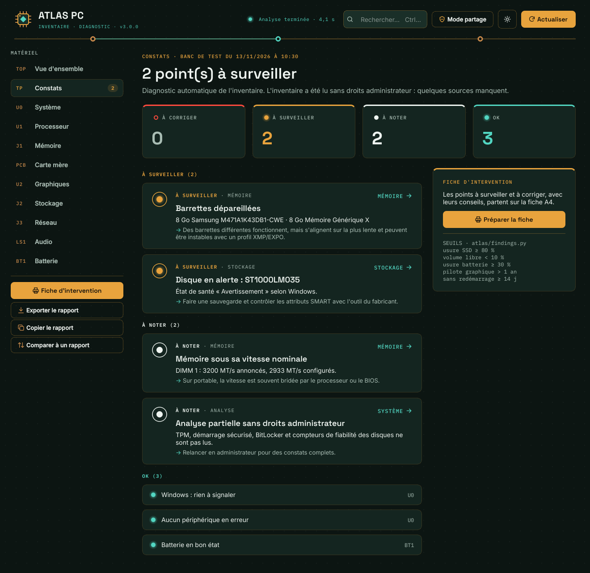
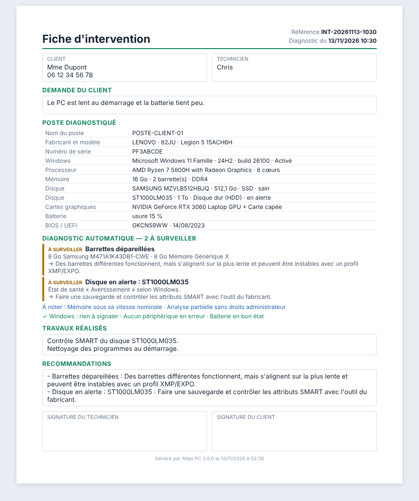
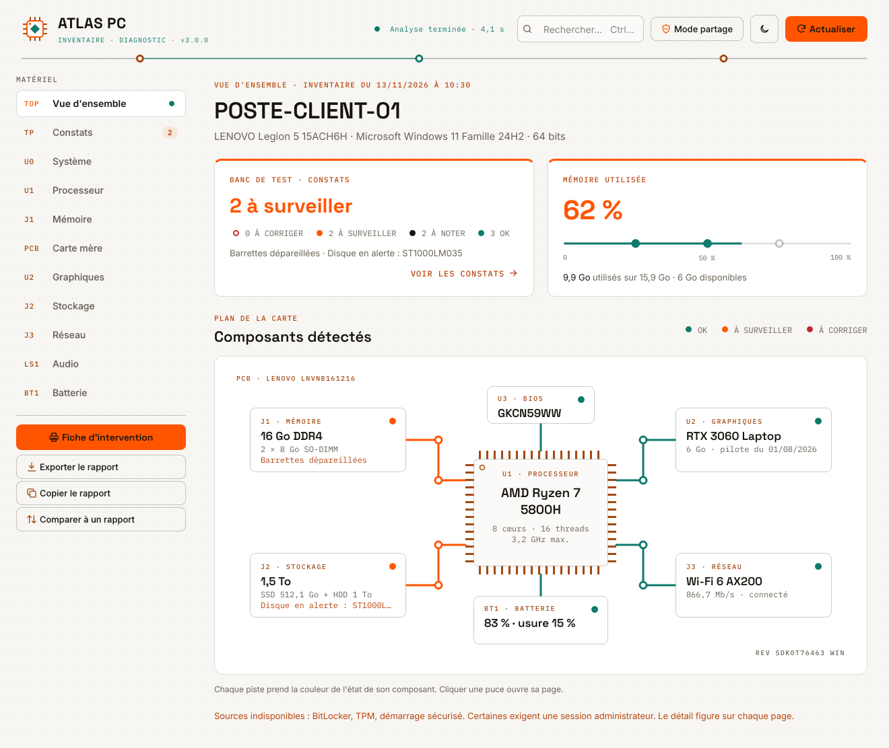

# Atlas PC

Inventaire matériel et diagnostic d'un PC Windows, en français, dans l'esprit de Speccy.
Atlas PC lit la configuration du poste, la traduit en **constats** (ce qui est à corriger,
à surveiller ou en ordre) et prépare une **fiche d'intervention** prête à imprimer.

L'interface reprend l'identité visuelle du site BAUSTECH PC :
l'application est dessinée comme une carte électronique.


> Toutes les captures sont faites avec l'inventaire d'exemple des tests, et non avec un vrai poste.
> Pour les régénérer : `python tools/captures.py`.

## Ce que fait Atlas PC

- **Inventaire complet** en une seule requête PowerShell/CIM : modèle du poste, BIOS/UEFI, processeur,
  mémoire (type, format, vitesses), cartes graphiques et écrans, disques (SSD/HDD réel, NVMe/SATA, santé,
  usure), volumes et BitLocker, réseau, audio, batterie, TPM, démarrage sécurisé, activation de Windows.
- **Constats automatiques**, avec un conseil pour chacun : mémoire en mono-canal ou sous sa vitesse
  nominale, barrettes dépareillées, disque en alerte ou usé, volume plein, batterie usée, Windows 10 en fin
  de support et éligibilité à Windows 11, pilote graphique générique ou ancien, périphériques en erreur…
- **Fiche d'intervention A4**, imprimable ou enregistrable en PDF.
- **Conseiller d'évolution mémoire** : quelles barrettes acheter, et comment passer à la capacité supérieure.
- **Mode partage** : masque les identifiants du poste avant une capture ou un export.
- **Comparaison** avec un ancien rapport : ce qui a changé sur le poste.
- **Exports** JSON, texte et HTML, et une **ligne de commande** pour tout faire sans interface.

## Aperçu

### Constats : le banc de test

Chaque point est classé *à corriger*, *à surveiller*, *à noter* ou *OK*, avec son explication, un conseil
et un lien vers la page concernée. Les seuils se règlent en tête de [`atlas/findings.py`](atlas/findings.py).



### Mémoire et conseiller d'évolution

Les barrettes sont dessinées, la barrette dépareillée est signalée, et le conseiller montre les évolutions
possibles d'après les emplacements, le type, le format et la capacité maximale de la carte mère.
Ici en thème clair.


### Fiche d'intervention

Le technicien saisit le client, la demande, les travaux et les recommandations ; un lien reprend les
conseils des constats. Laissés vides, les champs s'impriment comme des lignes à remplir à la main.

| Saisie dans l'application | Fiche imprimée (A4) |
| :---: | :---: |
|  |  |

### Mode partage

Un clic masque le nom du poste, le domaine, les numéros de série, la fin des adresses MAC et IPv4 et les
adresses IPv6, à l'écran comme dans les copies, les exports et la fiche.


### Pages de détail et thème clair

Chaque valeur se sélectionne et se copie (Ctrl+C, double-clic ou clic droit). La recherche (Ctrl+F)
parcourt toutes les pages sans tenir compte des accents.

| Stockage, thème sombre | Vue d'ensemble, thème clair |
| :---: | :---: |
|  |  |

## Installation et lancement

Windows 10 ou 11, avec Python 3.9 ou plus récent.

- **Le plus simple** : double-cliquer sur `lancer_atlas.bat`. Au premier lancement, il installe PySide6
  (l'interface graphique) pour l'utilisateur courant.
- **À la main** :

  ```
  python -m pip install -r requirements.txt
  python atlas_pc.py
  ```

Certaines sources (TPM, BitLocker, démarrage sécurisé, compteurs de fiabilité des disques, températures)
demandent une session administrateur : le bouton « Relancer en administrateur » apparaît quand c'est utile,
et chaque page indique pourquoi une information manque.

Raccourcis : **F5** pour actualiser, **Ctrl+F** pour rechercher, **Échap** pour sortir de la recherche.
Le thème (sombre ou clair), le mode partage et le nom du technicien sont mémorisés dans
`%APPDATA%\AtlasPC\config.json`.

## Ligne de commande

Les commandes sans interface n'ont pas besoin de PySide6.

```
python atlas_pc.py --json                    inventaire JSON sur la sortie standard
python atlas_pc.py --text                    rapport texte
python atlas_pc.py -o rapport.html           rapport dans un fichier (.json, .txt ou .html)
python atlas_pc.py --fiche -o fiche.html --client "Mme Dupont" --technicien Chris
                                             fiche d'intervention
python atlas_pc.py --json --anonyme          inventaire sans identifiants
python atlas_pc.py --debug                   journal détaillé dans le dossier temporaire
python atlas_pc.py --help
```

Le journal `--debug` contient l'inventaire brut, **non masqué**.

## Exécutable autonome

```
python -m pip install -r requirements-dev.txt
pyinstaller atlas_pc.spec --noconfirm
```

Le dossier `dist/AtlasPC/` est à distribuer entier (zippé). Le mode « onedir » est préféré au fichier
unique, plus souvent bloqué par les antivirus et SmartScreen.

## Développement

```
python -m pip install -r requirements-dev.txt
pytest                          tests (l'interface est testée sans écran)
ruff check . ; ruff format .    contrôle et mise en forme
python tools/captures.py        régénère les captures de ce README
python tools/check_scan.py scan.json
                                vérifie un inventaire Windows réel
```

La CI GitHub ([`.github/workflows/ci.yml`](.github/workflows/ci.yml)) lance les tests sous Linux et
Windows, fait un vrai inventaire sur Windows, le vérifie, puis construit et lance l'exécutable.
Les essais à faire à la main sur de vrais PC sont listés dans [`docs/ESSAIS-WINDOWS.md`](docs/ESSAIS-WINDOWS.md).

### Organisation du code

| Fichier | Rôle |
| --- | --- |
| `atlas_pc.py` | lanceur |
| `atlas/collect.py` | script PowerShell, appel, normalisation de l'inventaire |
| `atlas/findings.py` | règles des constats et leurs seuils |
| `atlas/pages.py` | contenu des pages, recherche, comparaison de rapports |
| `atlas/upgrade.py` | conseiller d'évolution mémoire |
| `atlas/fiche.py` | fiche d'intervention A4 |
| `atlas/privacy.py` | mode partage (masquage des identifiants) |
| `atlas/export.py` | exports JSON, texte et HTML |
| `atlas/formatting.py` | mise en forme des valeurs |
| `atlas/settings.py` | préférences, relance en administrateur |
| `atlas/gui/` | interface PySide6 : thème, plan de carte, barrettes, écrans, fenêtre |
| `tests/` | tests (pytest, pytest-qt) |
| `tools/` | vérification d'un inventaire réel, génération des captures |

## Licence

Code sous licence [MIT](LICENSE). Les polices embarquées (Space Grotesk, Inter, IBM Plex Mono) sont sous
licence SIL Open Font License ; leurs textes de licence sont dans [`atlas/gui/fonts/`](atlas/gui/fonts).
