# Atlas PC Monitor

**[English](#english)** · **[Français](#français)**

## English

A hardware inventory and diagnostic tool for Windows PCs, in the spirit of Speccy.
Atlas PC Monitor reads the machine's configuration, turns it into **findings** (what needs fixing,
what to keep an eye on, what is fine) and prepares a printable **intervention sheet**.

The interface is available in English and French: the **EN/FR** button in the header switches
language on the fly. Its visual identity comes from the BAUSTECH PC website: the application is drawn
like a circuit board.

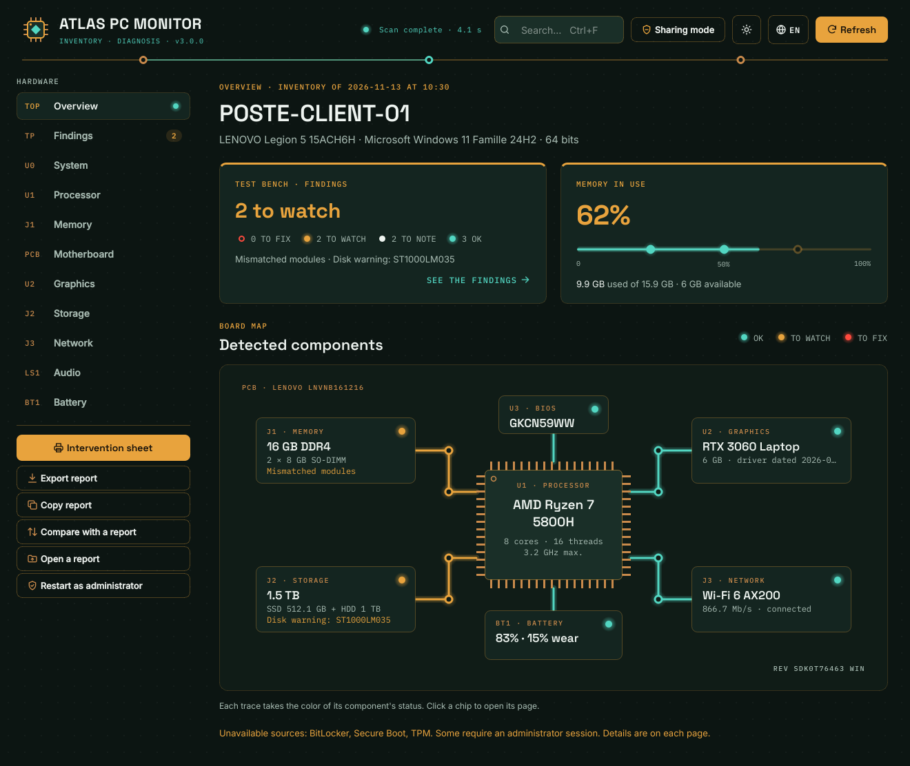

> All screenshots use the sample inventory from the tests, not a real machine.
> To regenerate them: `python tools/captures.py --lang en` (French: `python tools/captures.py`).

### What Atlas PC Monitor does

- **Full inventory** in a single PowerShell/CIM query: machine model, BIOS/UEFI, processor,
  memory (type, form factor, speeds), graphics cards and monitors, disks (actual SSD/HDD, NVMe/SATA, health,
  wear), volumes and BitLocker, network, audio, battery, TPM, Secure Boot, Windows activation.
- **Automatic findings**, each with a piece of advice: single-channel memory or memory below its rated
  speed, mismatched modules, failing or worn disk, full volume, worn battery, Windows 10 end of support and
  Windows 11 eligibility, generic or outdated graphics driver, devices in error…
- **A4 intervention sheet**, printable or saved as PDF.
- **Memory upgrade advisor**: which modules to buy, and how to reach the next capacity.
- **Sharing mode**: hides the machine's identifiers before a screenshot or an export.
- **Comparison** with an older report: what changed on the machine.
- **JSON, text and HTML exports**, and a **command line** to do everything without the interface.
- **Report viewer**, on Windows as well as on Linux (AppImage): open a JSON report made on another PC,
  with its findings, intervention sheet and comparison.
- **English and French**: interface, findings, reports and intervention sheet, switched with the **EN/FR**
  button or `--lang`.

### Screenshots

#### Findings: the test bench

Each item is rated *to fix*, *to watch*, *to note* or *OK*, with an
explanation, a piece of advice and a link to the relevant page. Thresholds are set at the top of
[`atlas/findings.py`](atlas/findings.py).

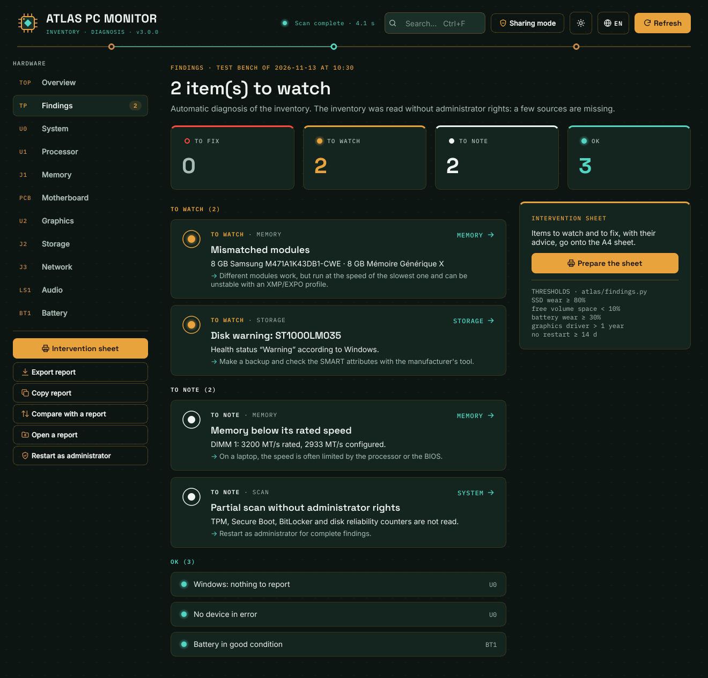

#### Memory and upgrade advisor

The memory modules are drawn, a mismatched module is flagged, and the advisor shows the possible upgrades
based on the motherboard's slots, memory type, form factor and maximum capacity. Shown here in the light theme.

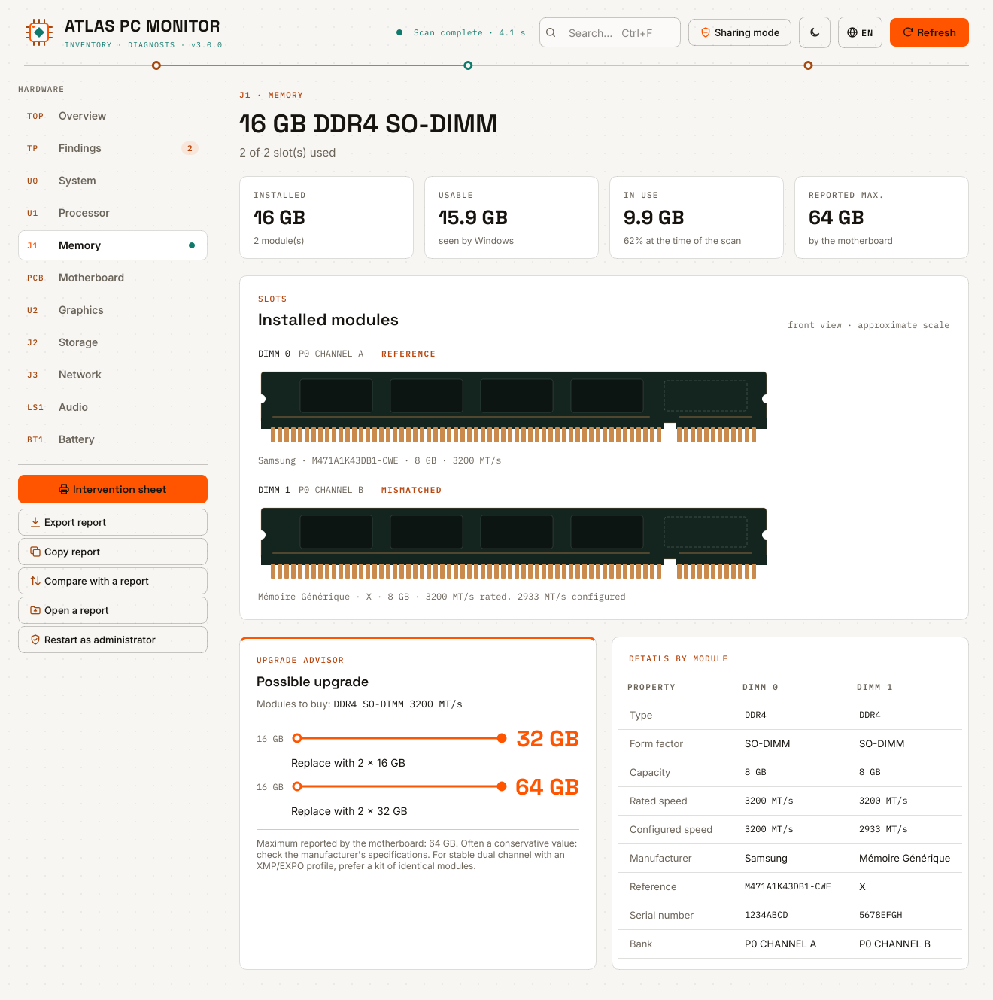

#### Intervention sheet

The technician fills in the customer, the request, the work done and the recommendations; one link imports
the advice from the findings. Fields left empty are printed as blank lines to fill in by hand.

| Entry in the application | Printed sheet (A4) |
| :---: | :---: |
| 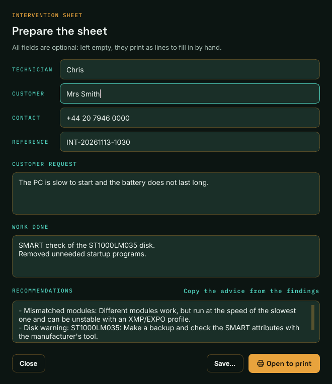 | 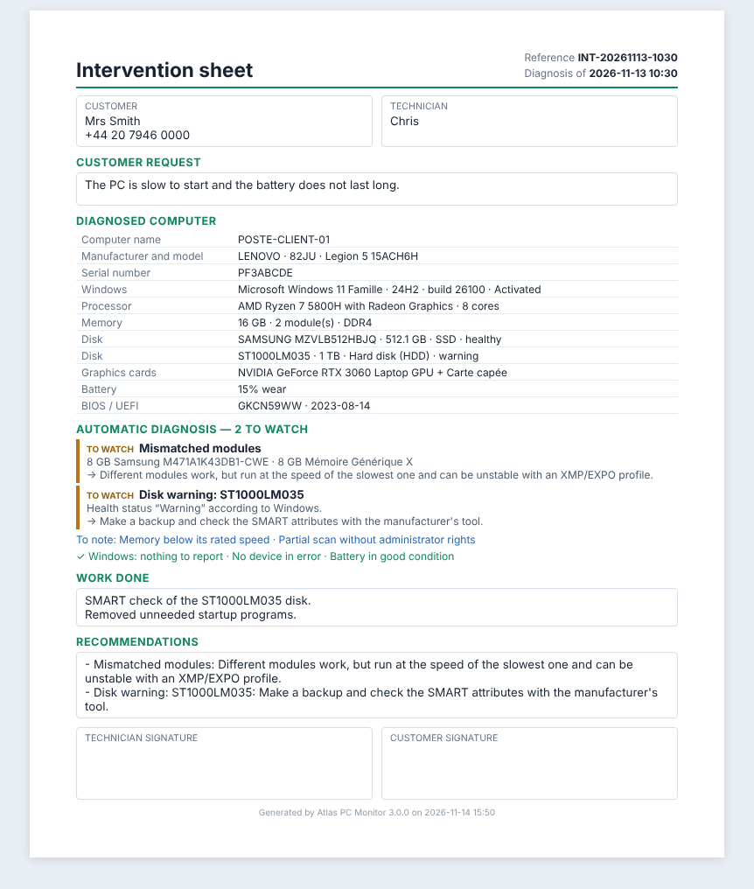 |

#### Sharing mode

One click hides the computer name, the domain, serial numbers, the end of MAC and IPv4 addresses and
IPv6 addresses, on screen as well as in copies, exports and the intervention sheet.

![Motherboard page in sharing mode: serial numbers replaced with “[hidden]”](docs/captures/en/mode-partage.png)

#### Detail pages and light theme

Every value can be selected and copied (Ctrl+C, double-click or right-click). Search (Ctrl+F)
goes through every page and ignores accents.

| Storage, dark theme | Overview, light theme |
| :---: | :---: |
| 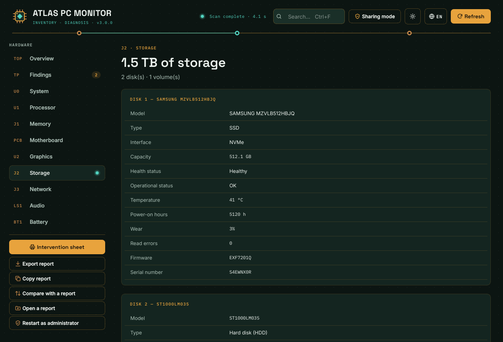 | 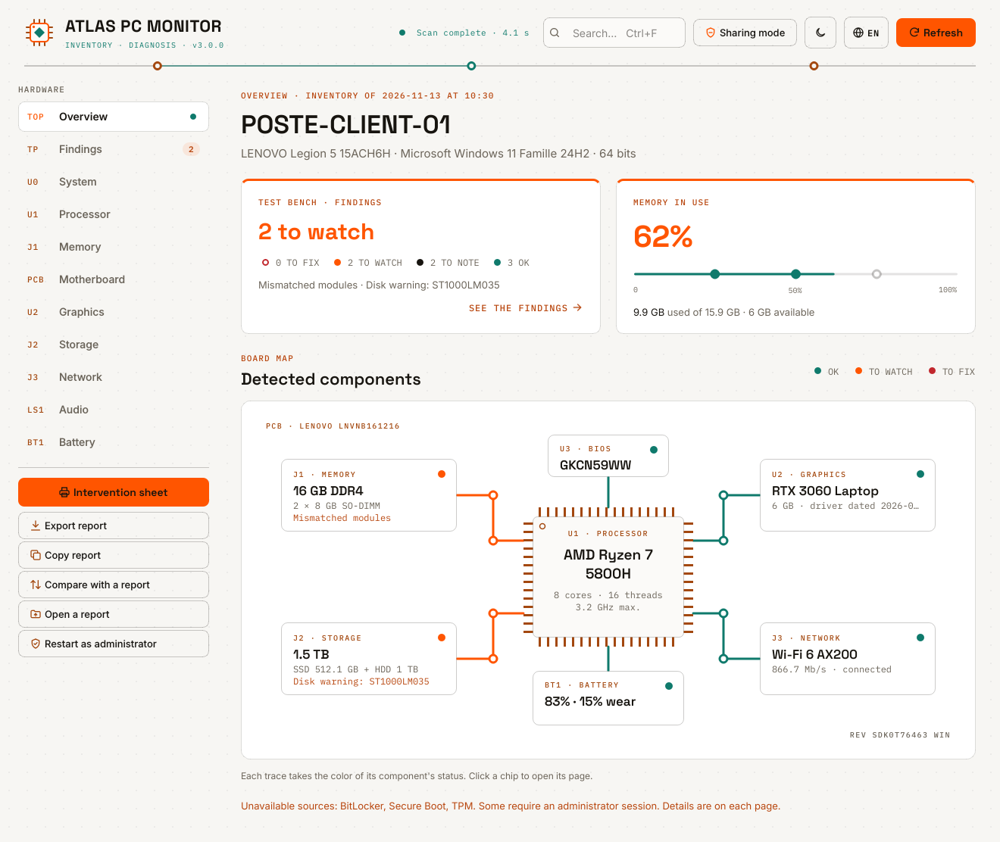 |

### Installation and launch

- **Without Python**: download `AtlasPCMonitor.exe` from the
  [Releases](https://github.com/Bulls64/atlas-pc/releases) page and run it (Windows 10 or 11).
  `AtlasPCMonitor-windows.zip` holds the same application as a folder: it starts faster and triggers
  fewer antivirus warnings.

With Python 3.9 or later:

- **Easiest**: double-click `lancer_atlas.bat`. On first launch, it installs PySide6
  (the graphical interface) for the current user.
- **By hand**:

  ```
  python -m pip install -r requirements.txt
  python atlas_pc.py
  ```

Some sources (TPM, BitLocker, Secure Boot, disk reliability counters, temperatures) require an
administrator session: the “Restart as administrator” button appears
when it helps, and each page explains why a piece of information is missing.

Shortcuts: **F5** to refresh, **Ctrl+F** to search, **Esc** to leave the search.
The language, theme (dark or light), sharing mode and technician name are saved in
`%APPDATA%\AtlasPC\config.json`. On first launch, the language follows the Windows display language
(French if Windows is in French, English otherwise).

### Command line

Commands without the interface do not need PySide6. Option names are in French; `--lang en` gives
the help, messages and reports in English.

```
python atlas_pc.py --json                    JSON inventory on standard output
python atlas_pc.py --text                    text report
python atlas_pc.py -o report.html            report to a file (.json, .txt or .html)
python atlas_pc.py --fiche -o sheet.html --client "Jane Smith" --technicien Chris
                                             intervention sheet
python atlas_pc.py --json --anonyme          inventory without identifiers
python atlas_pc.py report.json               opens a JSON report in the interface
python atlas_pc.py --fiche report.json -o sheet.html
                                             sheet for an existing report, without scanning this PC
python atlas_pc.py --lang en --text          report in English (--lang fr: in French)
python atlas_pc.py --debug                   detailed log in the temporary folder
python atlas_pc.py --help
```

The `--debug` log contains the raw inventory, **not masked**.

### Standalone executable

```
python -m pip install -r requirements-dev.txt pillow
set "QT_QPA_PLATFORM=offscreen" && python tools/make_icon.py build/atlas-pc-monitor.ico
pyinstaller atlas_pc.spec --noconfirm                           → dist/AtlasPCMonitor/ folder
set "ATLAS_ONEFILE=1" && pyinstaller atlas_pc.spec --noconfirm   → single file dist/AtlasPCMonitor.exe
```

The folder (“onedir”) is distributed whole, zipped: it starts faster and antivirus software and
SmartScreen flag it less often. The single file is easier to carry around, but unpacks itself to the
temporary folder on every launch. Pushing a `v*` tag makes the CI publish both, along with the AppImage,
as a GitHub release.

### Linux: AppImage

The inventory is done on Windows. On Linux, Atlas PC Monitor is a **viewer**: it opens JSON reports made on
Windows PCs (“Export report” button, or `AtlasPCMonitor.exe --json -o report.json`) and derives
findings, the intervention sheet, exports and comparison from them.

```
chmod +x AtlasPCMonitor-3.0.0-x86_64.AppImage
./AtlasPCMonitor-3.0.0-x86_64.AppImage                    interface
./AtlasPCMonitor-3.0.0-x86_64.AppImage report.json        opens a report directly
./AtlasPCMonitor-3.0.0-x86_64.AppImage --fiche report.json -o sheet.html
```

A report can also be opened by dragging it onto the window, or with Ctrl+O. If the AppImage does not
start because FUSE is missing, install `libfuse2` (or run it with `--appimage-extract-and-run`).

The CI AppImage (“AppImage Linux” job) is built on Ubuntu 22.04: it runs on distributions with
glibc 2.35 or later. To build it yourself:

```
sudo apt install libxcb-cursor0 squashfs-tools
python -m pip install -r requirements-dev.txt
tools/build_appimage.sh                            → dist/AtlasPCMonitor-<version>-x86_64.AppImage
```

The script assembles the AppImage without appimagetool: a squashfs image of the PyInstaller folder,
preceded by the official AppImage runtime, pinned to a dated release and checked against its SHA-256 hash.

### Development

```
python -m pip install -r requirements-dev.txt
pytest                          tests (the interface is tested headless)
ruff check . ; ruff format .    linting and formatting
python tools/captures.py [--lang en]
                                regenerates the screenshots in this README
python tools/check_scan.py scan.json
                                checks a real Windows inventory
```

The GitHub CI ([`.github/workflows/ci.yml`](.github/workflows/ci.yml)) runs the tests on Linux and
Windows, takes a real inventory on Windows and checks it, builds and runs the Windows executable, then
builds and tries the Linux AppImage.
The manual checks to run on real PCs are listed (in French) in [`docs/ESSAIS-WINDOWS.md`](docs/ESSAIS-WINDOWS.md).

#### Code layout

| File | Role |
| --- | --- |
| `atlas_pc.py` | launcher |
| `atlas/collect.py` | PowerShell script, call, inventory normalization |
| `atlas/findings.py` | finding rules and their thresholds |
| `atlas/pages.py` | page content, search, report comparison |
| `atlas/upgrade.py` | memory upgrade advisor |
| `atlas/fiche.py` | A4 intervention sheet |
| `atlas/privacy.py` | sharing mode (identifier masking) |
| `atlas/export.py` | JSON, text and HTML exports |
| `atlas/formatting.py` | value formatting (numbers, units and dates follow the language) |
| `atlas/i18n.py`, `atlas/locale_en.py` | language choice and English catalog |
| `atlas/settings.py` | preferences, restart as administrator |
| `atlas/gui/` | PySide6 interface: theme, board map, memory modules, screens, window |
| `tests/` | tests (pytest, pytest-qt) |
| `tools/` | real inventory check, screenshots, icon, AppImage build |
| `packaging/linux/` | AppImage launcher and `.desktop` shortcut |

### License

Code under the [MIT](LICENSE) license. The bundled fonts (Space Grotesk, Inter, IBM Plex Mono) are under
the SIL Open Font License; their license texts are in [`atlas/gui/fonts/`](atlas/gui/fonts).

---

## Français

Inventaire matériel et diagnostic d'un PC Windows, dans l'esprit de Speccy.
Atlas PC Monitor lit la configuration du poste, la traduit en **constats** (ce qui est à corriger,
à surveiller ou en ordre) et prépare une **fiche d'intervention** prête à imprimer.

L'interface existe en français et en anglais : le bouton **FR/EN** de l'en-tête change de langue à la
volée. Elle reprend l'identité visuelle du site BAUSTECH PC : l'application est dessinée comme une
carte électronique.

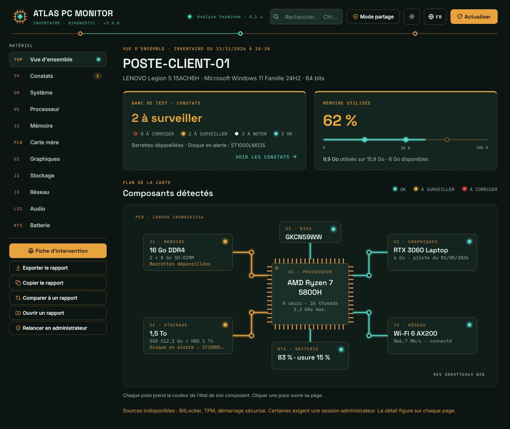

> Toutes les captures sont faites avec l'inventaire d'exemple des tests, et non avec un vrai poste.
> Pour les régénérer : `python tools/captures.py` (en anglais : `python tools/captures.py --lang en`).

### Ce que fait Atlas PC Monitor

- **Inventaire complet** en une seule requête PowerShell/CIM : modèle du poste, BIOS/UEFI, processeur,
  mémoire (type, format, vitesses), cartes graphiques et écrans, disques (SSD/HDD réel, NVMe/SATA, santé,
  usure), volumes et BitLocker, réseau, audio, batterie, TPM, démarrage sécurisé, activation de Windows.
- **Constats automatiques**, avec un conseil pour chacun : mémoire en mono-canal ou sous sa vitesse
  nominale, barrettes dépareillées, disque en alerte ou usé, volume plein, batterie usée, Windows 10 en fin
  de support et éligibilité à Windows 11, pilote graphique générique ou ancien, périphériques en erreur…
- **Fiche d'intervention A4**, imprimable ou enregistrable en PDF.
- **Conseiller d'évolution mémoire** : quelles barrettes acheter, et comment passer à la capacité supérieure.
- **Mode partage** : masque les identifiants du poste avant une capture ou un export.
- **Comparaison** avec un ancien rapport : ce qui a changé sur le poste.
- **Exports** JSON, texte et HTML, et une **ligne de commande** pour tout faire sans interface.
- **Visionneuse de rapports**, sous Windows comme sous Linux (AppImage) : ouvrir un rapport JSON fait
  sur un autre PC, avec ses constats, sa fiche d'intervention et la comparaison.
- **Français et anglais** : interface, constats, rapports et fiche d'intervention, au choix avec le bouton
  **FR/EN** ou `--lang`.

### Aperçu

#### Constats : le banc de test

Chaque point est classé *à corriger*, *à surveiller*, *à noter* ou *OK*, avec son explication, un conseil
et un lien vers la page concernée. Les seuils se règlent en tête de [`atlas/findings.py`](atlas/findings.py).


#### Mémoire et conseiller d'évolution

Les barrettes sont dessinées, la barrette dépareillée est signalée, et le conseiller montre les évolutions
possibles d'après les emplacements, le type, le format et la capacité maximale de la carte mère.
Ici en thème clair.

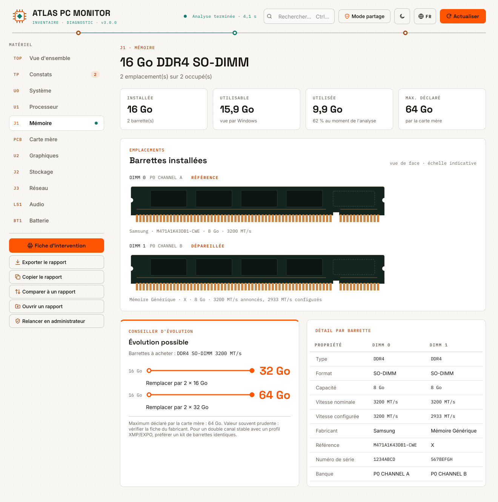

#### Fiche d'intervention

Le technicien saisit le client, la demande, les travaux et les recommandations ; un lien reprend les
conseils des constats. Laissés vides, les champs s'impriment comme des lignes à remplir à la main.

| Saisie dans l'application | Fiche imprimée (A4) |
| :---: | :---: |
| 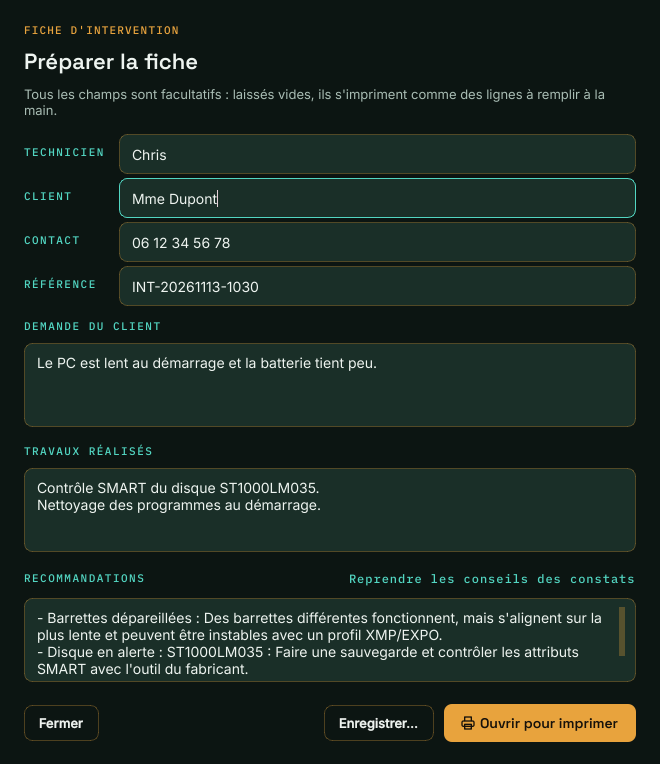 |  |

#### Mode partage

Un clic masque le nom du poste, le domaine, les numéros de série, la fin des adresses MAC et IPv4 et les
adresses IPv6, à l'écran comme dans les copies, les exports et la fiche.

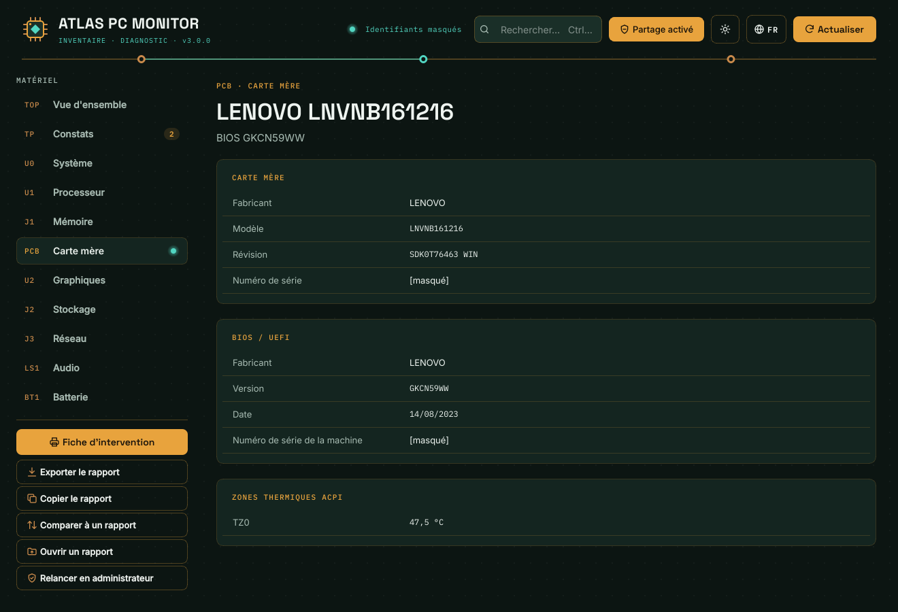

#### Pages de détail et thème clair

Chaque valeur se sélectionne et se copie (Ctrl+C, double-clic ou clic droit). La recherche (Ctrl+F)
parcourt toutes les pages sans tenir compte des accents.

| Stockage, thème sombre | Vue d'ensemble, thème clair |
| :---: | :---: |
| 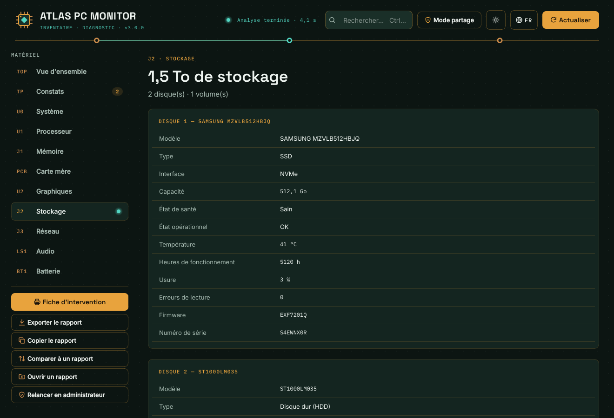 |  |

### Installation et lancement

- **Sans Python** : télécharger `AtlasPCMonitor.exe` sur la page
  [Releases](https://github.com/Bulls64/atlas-pc/releases) et le lancer (Windows 10 ou 11).
  `AtlasPCMonitor-windows.zip` contient la même application en dossier : elle démarre plus vite et alerte moins
  les antivirus.

Avec Python 3.9 ou plus récent :

- **Le plus simple** : double-cliquer sur `lancer_atlas.bat`. Au premier lancement, il installe PySide6
  (l'interface graphique) pour l'utilisateur courant.
- **À la main** :

  ```
  python -m pip install -r requirements.txt
  python atlas_pc.py
  ```

Certaines sources (TPM, BitLocker, démarrage sécurisé, compteurs de fiabilité des disques, températures)
demandent une session administrateur : le bouton « Relancer en administrateur » apparaît quand c'est utile,
et chaque page indique pourquoi une information manque.

Raccourcis : **F5** pour actualiser, **Ctrl+F** pour rechercher, **Échap** pour sortir de la recherche.
La langue, le thème (sombre ou clair), le mode partage et le nom du technicien sont mémorisés dans
`%APPDATA%\AtlasPC\config.json`. Au premier lancement, la langue suit celle de l'affichage de Windows
(français si Windows est en français, anglais sinon).

### Ligne de commande

Les commandes sans interface n'ont pas besoin de PySide6.

```
python atlas_pc.py --json                    inventaire JSON sur la sortie standard
python atlas_pc.py --text                    rapport texte
python atlas_pc.py -o rapport.html           rapport dans un fichier (.json, .txt ou .html)
python atlas_pc.py --fiche -o fiche.html --client "Mme Dupont" --technicien Chris
                                             fiche d'intervention
python atlas_pc.py --json --anonyme          inventaire sans identifiants
python atlas_pc.py rapport.json              ouvre un rapport JSON dans l'interface
python atlas_pc.py --fiche rapport.json -o fiche.html
                                             fiche d'un rapport déjà fait, sans analyser ce poste
python atlas_pc.py --lang en --text          rapport en anglais (--lang fr : en français)
python atlas_pc.py --debug                   journal détaillé dans le dossier temporaire
python atlas_pc.py --help
```

Le journal `--debug` contient l'inventaire brut, **non masqué**.

### Exécutable autonome

```
python -m pip install -r requirements-dev.txt pillow
set "QT_QPA_PLATFORM=offscreen" && python tools/make_icon.py build/atlas-pc-monitor.ico
pyinstaller atlas_pc.spec --noconfirm                           → dossier dist/AtlasPCMonitor/
set "ATLAS_ONEFILE=1" && pyinstaller atlas_pc.spec --noconfirm   → fichier unique dist/AtlasPCMonitor.exe
```

Le dossier (« onedir ») se distribue entier, zippé : il démarre plus vite et les antivirus comme
SmartScreen le signalent moins souvent. Le fichier unique se transporte plus facilement, mais se
décompresse dans le dossier temporaire à chaque lancement. Un tag `v*` poussé fait publier les deux par
la CI, avec l'AppImage, dans une release GitHub.

### Linux : AppImage

L'inventaire se fait sous Windows. Sous Linux, Atlas PC Monitor est une **visionneuse** : il ouvre les rapports
JSON faits sur des PC Windows (bouton « Exporter le rapport », ou `AtlasPCMonitor.exe --json -o rapport.json`)
et en tire constats, fiche d'intervention, exports et comparaison.

```
chmod +x AtlasPCMonitor-3.0.0-x86_64.AppImage
./AtlasPCMonitor-3.0.0-x86_64.AppImage                    interface
./AtlasPCMonitor-3.0.0-x86_64.AppImage rapport.json       ouvre directement un rapport
./AtlasPCMonitor-3.0.0-x86_64.AppImage --fiche rapport.json -o fiche.html
```

Un rapport s'ouvre aussi par glisser-déposer sur la fenêtre, ou avec Ctrl+O. Si l'AppImage ne démarre
pas faute de FUSE, installer `libfuse2` (ou lancer avec `--appimage-extract-and-run`).

L'AppImage de la CI (job « AppImage Linux ») est construite sur Ubuntu 22.04 : elle tourne sur les
distributions dont la glibc vaut 2.35 ou plus. Pour la construire soi-même :

```
sudo apt install libxcb-cursor0 squashfs-tools
python -m pip install -r requirements-dev.txt
tools/build_appimage.sh                            → dist/AtlasPCMonitor-<version>-x86_64.AppImage
```

Le script assemble l'AppImage sans appimagetool : image squashfs du dossier PyInstaller, précédée du
runtime AppImage officiel, épinglé à une version datée et vérifié par son empreinte SHA-256.

### Développement

```
python -m pip install -r requirements-dev.txt
pytest                          tests (l'interface est testée sans écran)
ruff check . ; ruff format .    contrôle et mise en forme
python tools/captures.py [--lang en]
                                régénère les captures de ce README
python tools/check_scan.py scan.json
                                vérifie un inventaire Windows réel
```

La CI GitHub ([`.github/workflows/ci.yml`](.github/workflows/ci.yml)) lance les tests sous Linux et
Windows, fait un vrai inventaire sur Windows, le vérifie, construit et lance l'exécutable Windows, puis
construit et essaie l'AppImage Linux.
Les essais à faire à la main sur de vrais PC sont listés dans [`docs/ESSAIS-WINDOWS.md`](docs/ESSAIS-WINDOWS.md).

#### Organisation du code

| Fichier | Rôle |
| --- | --- |
| `atlas_pc.py` | lanceur |
| `atlas/collect.py` | script PowerShell, appel, normalisation de l'inventaire |
| `atlas/findings.py` | règles des constats et leurs seuils |
| `atlas/pages.py` | contenu des pages, recherche, comparaison de rapports |
| `atlas/upgrade.py` | conseiller d'évolution mémoire |
| `atlas/fiche.py` | fiche d'intervention A4 |
| `atlas/privacy.py` | mode partage (masquage des identifiants) |
| `atlas/export.py` | exports JSON, texte et HTML |
| `atlas/formatting.py` | mise en forme des valeurs (nombres, unités et dates suivent la langue) |
| `atlas/i18n.py`, `atlas/locale_en.py` | choix de la langue et catalogue anglais |
| `atlas/settings.py` | préférences, relance en administrateur |
| `atlas/gui/` | interface PySide6 : thème, plan de carte, barrettes, écrans, fenêtre |
| `tests/` | tests (pytest, pytest-qt) |
| `tools/` | vérification d'un inventaire réel, captures, icône, construction de l'AppImage |
| `packaging/linux/` | lanceur et raccourci `.desktop` de l'AppImage |

### Licence

Code sous licence [MIT](LICENSE). Les polices embarquées (Space Grotesk, Inter, IBM Plex Mono) sont sous
licence SIL Open Font License ; leurs textes de licence sont dans [`atlas/gui/fonts/`](atlas/gui/fonts).
